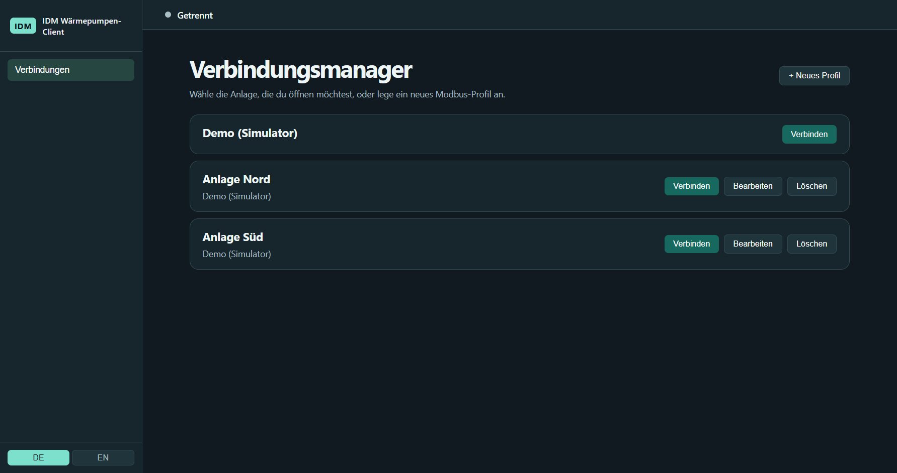

# IDM Heatpump Client · Benutzerhandbuch

[English](#english) · [README](../README.md) · [Änderungsprotokoll](../CHANGELOG.md)

Diese Anleitung beschreibt den aktuellen Entwicklungsstand. Für veröffentlichte Installer siehe [Releases](https://github.com/Xerolux/idm-heatpump-client/releases).

Bei einer Windows-Neuinstallation zeigt der Setup-Assistent die MIT-Lizenz an. Wähle **Annehmen**, um mit der Installation fortzufahren.

## Einstellungen sichern

Beende den Client und kopiere `idm-heatpump-client.json` aus dem Anwendungsdatenordner **IDM Heatpump Client** an einen geschützten Ort. Die Datei enthält die lokalen Client-Einstellungen und Verbindungsprofile. Den Ordner findest du unter Windows üblicherweise in `%APPDATA%`, unter macOS in `~/Library/Application Support` und unter Linux in `$XDG_CONFIG_HOME` (standardmäßig `~/.config`). Zum Wiederherstellen kopierst du die Datei bei beendetem Client zurück. Halte relevante Reglerwerte vor einer Anlagenänderung getrennt fest. Ein vollständiges Regler-Backup und dessen Wiederherstellung erfolgen über die dafür vorgesehenen Funktionen des Reglers oder Servicewerkzeugs.

## Demo starten

Ab v0.4.0 stehen die Live-Übersicht für eine Anlage und eine einmalige Diagramm-Demo mit Free zur Verfügung. Standard schaltet Diagramme und CSV frei, Pro zusätzlich PDF und Druck ohne Wasserzeichen. Ultra ergänzt weitere Anlagenplätze. Ab v0.4.1 zeigt der Client oben rechts deine Lizenzstufe. Klicke darauf, um die Freischaltung zu öffnen. Hast du bereits einen 32-stelligen Aktivierungscode von Xerolux, gib ihn mit der zugehörigen E-Mail-Adresse ein. Der anschließende achtstellige E-Mail-Code bestätigt deine Adresse. [Zur Kaufseite · Coming soon](https://license.xerolux.de/kaufen). Für spätere Prüfungen darf der Client bis zu 72 Stunden offline sein. Bestehende Profile bleiben gespeichert, auch wenn ein Anlagenplatz gerade nicht freigeschaltet ist.

Öffne den Client, wähle im **Verbindungsmanager** das Profil **Demo (Simulator)** und klicke auf **Verbinden**. Sobald der erste Lesezyklus erfolgreich ist, erscheint die Übersicht. Die Messwerte stammen aus dem Simulator.

## Mehrere Anlagen einrichten

1. Aktiviere Modbus TCP am Navigator und prüfe IP-Adresse, Port und Slave-ID.
2. Wähle **Neues Profil**, gib der Anlage einen eindeutigen Namen und trage die Verbindungsdaten ein. Die Vorgaben sind Port **502**, Slave-ID **1** und ein Leseintervall von **1.000 ms**.
3. Speichere für jede Anlage ein eigenes Profil. Wähle die gewünschte Anlage beim Programmstart oder später unter **Verbindungen**. Der Client verbindet sich jeweils mit der ausgewählten Anlage.
4. Bei einem Verbindungsfehler bleibst du beim ersten Start im Verbindungsmanager. Prüfe die angezeigte Meldung und bei Bedarf das **Protokoll**.

## Messwerte und Diagnose

- **Übersicht** zeigt die verfügbaren Messwerte und den Anlagenstatus. Das Schema ist eine vereinfachte Darstellung. Ein Strich steht für einen fehlenden Messwert.
- Unter **Diagramme** kannst du Register auswählen und Messwerte als CSV exportieren. Messverläufe werden für die Sitzung der ausgewählten Anlage gehalten.
- **Register** zeigt Werte, Adressen und Lesediagnostik. Ein Schreibbefehl kann Reglereinstellungen ändern. Mit **Probelauf** prüfst du die Eingabe, ohne sie zu senden.
- Unter **Störcodes** kannst du nach Codes und deutschen Anwendungs- oder Servicehinweisen suchen.

## Desktop

Wechsle oben in der App oder unter **Einstellungen → Darstellung** zwischen **Hell** und **Dunkel**. Die Auswahl wird gespeichert.

Unter **Einstellungen → Desktop** kannst du **Beim Anmelden starten** und **In den Infobereich minimieren** unabhängig aktivieren. Beim Minimieren läuft die verbundene Anlage weiter. Öffne das Fenster wieder über das Symbol im Infobereich oder über die App-Verknüpfung. **Beenden** im Symbolmenü schließt den Client.

Der Autostart steht in installierten Versionen zur Verfügung. Mit aktivierter Infobereich-Option startet die App bei der Anmeldung im Hintergrund. Wähle danach im Verbindungsmanager ein Profil. Unter macOS können die Systemeinstellungen eine Freigabe verlangen. Linux nutzt den Autostart des jeweiligen Desktops. Beim Verschieben einer AppImage-Datei schalte den Autostart am neuen Speicherort erneut ein.

## Live-Auswertung und A4-Berichte

Öffne **Diagramme** und wähle bis zu acht Messreihen. Einheiten wie °C und kW bekommen getrennte Diagramme. Die Auswahl und das Zeitfenster werden pro Anlagenprofil gespeichert. Mit **Pausieren** frierst du die Ansicht ein und kannst einen Diagrammausschnitt mit der Maus aufziehen. **Fortsetzen** führt zurück zur Live-Ansicht. Die Karten zeigen Minimum, Maximum und Durchschnitt je Messreihe für den gewählten Zeitraum. Unter **Zeitstrahl** kannst du die aufgezeichneten Werte mit Zeitstempel durchblättern.

Wähle **Live-Auswertung** für Diagramme und eine Tabelle mit letztem Wert, Minimum, Maximum, arithmetischem Mittel und Anzahl der Messpunkte. **Aktuelle Messwerte** gibt nur die letzten Werte aus. Über **Als PDF speichern** oder **Drucken** erhältst du einen A4-Bericht mit dem Anlagenprofil, der Softwareversion und dem diagonalen Xerolux-Wasserzeichen. Der Bericht übernimmt die gewählte Sprache.

## Deinstallation

- **Windows:** Wähle **IDM Heatpump Client** in **Einstellungen → Apps → Installierte Apps** und dann **Deinstallieren**. Der mitgelieferte Deinstaller entfernt das Programm und seine Verknüpfungen sowie Profile, Einstellungen, lokalen Cache und den Autostart-Eintrag des aktuellen Windows-Kontos. Ein Update behält diese Daten.
- **Linux:** Deaktiviere bei Bedarf den Autostart in der App und beende den Client. Entferne das DEB über die Paketverwaltung oder lösche die AppImage-Datei. Für die restlichen Benutzerdaten entferne den Ordner **IDM Heatpump Client** unter `$XDG_CONFIG_HOME` (standardmäßig `~/.config`). Falls ein Autostart-Eintrag übrig ist, entferne dort unter `autostart` die Datei `idm-heatpump-client.desktop`.
- **macOS:** Entferne den Client aus **Systemeinstellungen → Allgemein → Anmeldeobjekte**, beende die App und ziehe sie in den Papierkorb. Für die restlichen Benutzerdaten entferne den Ordner **IDM Heatpump Client** unter `~/Library/Application Support`.

Kopiere benötigte Profile vor der vollständigen Deinstallation. Separat gespeicherte PDF- und CSV-Exporte bleiben erhalten.

## Info, Hilfe und Spenden

Unter **Info** findest du die installierte Version und Links zu Handbuch, Downloads, Changelog, Quellcode und Lizenzen. Einen sichtbaren Verbindungsfehler kannst du direkt aus der Statusleiste melden. Für eine allgemeine Frage oder Rückmeldung öffne das Formular über **Info**.

Schreibe einen Betreff und beschreibe die Schritte. Du kannst Version, Betriebssystem und Verbindungsstatus in die Vorschau aufnehmen. Protokolle, Profilnamen, Netzwerkadressen und Messwerte werden nicht automatisch übernommen. Beim privaten E-Mail-Weg öffnet die App einen Entwurf an `git@xerolux.de`. Bei längeren Berichten füge den kopierten Text aus der Zwischenablage ein. Auf GitHub kannst du den Text in ein öffentliches Issue einfügen. Das Absenden oder Veröffentlichen erfolgt erst im jeweiligen Programm durch dich.

Unter **Spenden** findest du GitHub Sponsors, Patreon, Ko-fi, Buy Me a Coffee, PayPal und den Tesla-Empfehlungslink.

## Updates

Ab **v0.3.2** öffnet sich beim Start ein Fenster, sobald eine neuere Version verfügbar ist. Es zeigt den Changelog und bietet **Jetzt updaten** und **Später**. Unter **Updates** in der Titelleiste kannst du erneut prüfen oder das Fenster wieder öffnen. **Jetzt updaten** lädt und prüft das Paket und startet anschließend die Installation. Bei Linux-DEB und macOS öffnet sich der Ordner mit dem geprüften Paket zur manuellen Installation. Unter v0.3.1 findest du das Update auf v0.3.2 über **Updates** in der Titelleiste.

## English

This guide describes the current development version. Download published installers from [Releases](https://github.com/Xerolux/idm-heatpump-client/releases).

For a fresh Windows installation, the setup wizard displays the MIT license. Select **I Agree** to continue.

### Back up settings

Quit the client and copy `idm-heatpump-client.json` from the **IDM Heatpump Client** application data folder to a protected location. The file contains local client preferences and connection profiles. The folder is typically under `%APPDATA%` on Windows, `~/Library/Application Support` on macOS, or `$XDG_CONFIG_HOME` (normally `~/.config`) on Linux. To restore, copy the file back while the client is closed. Record relevant controller settings separately before changing the system. For full controller backup and recovery, use the controller or service tool's dedicated function.

### Connect to a heat pump

Starting with v0.4.0, Free includes the live overview for one heat pump and a one-time chart demo. Standard adds charts and CSV, Pro adds watermark-free PDF and printing, and Ultra adds heat-pump slots. Starting with v0.4.1, your license tier appears in the upper-right corner. Select it to open activation. If Xerolux has issued you a 32-character activation code, enter it with the associated email address. The eight-digit code sent to your inbox confirms that address. [Purchase page · Coming soon](https://license.xerolux.de/kaufen). The client may be offline for up to 72 hours between checks. Existing profiles remain saved when a slot is unavailable.

The **Connection manager** opens at startup. Choose **Demo (simulator)** to try the app without hardware. The dashboard opens after the first successful poll. Use **EN** to switch the interface language.

For a real installation, enable Modbus TCP on the Navigator and enter its IP address under **New profile**. Verify the port and slave ID on the controller. The client defaults to port **502**, slave ID **1**, and a polling interval of **1,000 ms**. Save a separate profile for each installation. Open **Connections** to switch to a different installation. If the first connection fails, check the displayed error and expand **Log** for details.

### Readings and diagnostics

- **Dashboard** shows available readings and system status. The hydraulic diagram is simplified. A dash marks an unavailable reading.
- **Charts** lets you select registers and export data as CSV. History is held for the current installation session.
- **Registers** shows addresses, live values and read diagnostics. Use **Dry run** to validate a write without sending it to the controller.
- **Error codes** provides searchable codes and available German user and service descriptions.

### Updates

Starting with **v0.3.2**, a dialog appears at startup when a newer version is available. It shows the changelog and offers **Update now** and **Later**. Use **Updates** in the title bar to check again or reopen the dialog. **Update now** downloads and verifies the package before starting the installer. For Linux DEB and macOS, it reveals the verified package for manual installation. In v0.3.1, open **Updates** in the title bar to get v0.3.2.

### Live analysis and A4 reports

Under **Charts**, select up to eight series and set a time range. The selection is remembered per installation profile. Pause the live view to zoom into an interval. Choose **Live analysis** for charts and statistics or **Current readings** for a compact table. **Save as PDF** and **Print** use A4, the selected language, the application version and a diagonal Xerolux watermark.

### About and reporting

Use **About** to check the installed version, browse links, donate or write a report. Review the preview first. App version, operating system and connection status are optional. Use the private email draft or copy the text into a public GitHub issue. The app does not automatically send a report.

### Desktop and timeline

Use **Settings → Desktop** to enable start at login and minimize to the system tray independently. The connection stays active while minimized. Reopen from the tray or app shortcut. In **Charts**, the metric cards show minimum, maximum and average for the selected time range. **Timeline** lists the captured readings with timestamps.

### Appearance and removal

Switch between **Light** and **Dark** from the top bar or in **Settings → Appearance**. On Windows, the supplied uninstaller removes the app and the current account’s settings, profiles, update cache, shortcuts and startup entry. Updates retain app data. On Linux and macOS, uninstall the app and remove the per-user data as described in [Deinstallation](#deinstallation).
